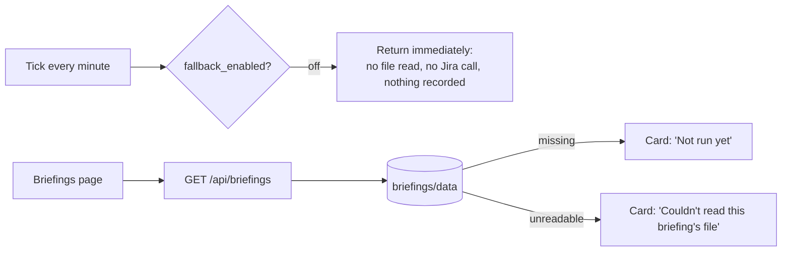
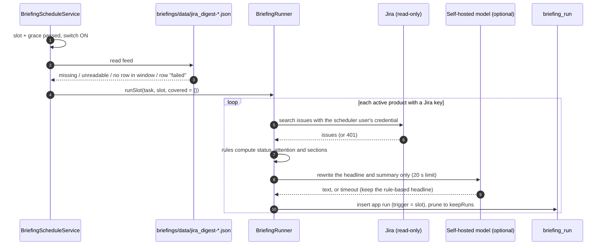

# Briefings: how the app connects to Claude's data

This document describes how the Briefings feature (Phase 17.1) gets Claude's results, and what the app does when Claude
is available or unavailable. It covers the three Jira briefings that have an app fallback:

- `jira_digest`
- `sprint_check`
- `weekly_status`

The two display-only briefings, `reg_watch` and `gulf_invest`, are also covered.

## 1. The short version

- **Claude and the app never call each other.** The only link is a folder of JSON files, one per run: `briefings/data/<task>-<UTC timestamp>.json`.
  Claude, or whatever runs the Claude task, writes these files. The app only reads them, through a read-only mount.
- **Whether the app runs a briefing itself depends on one switch.** Settings › Briefings › "Claude unavailable: run
  briefings in the app" (`briefing_settings.fallback_enabled`) is **off by default** (D-17.1-24).
  - **Off:** the scheduler does nothing at all. The page shows only what Claude wrote.
  - **On:** at each scheduled slot the app checks whether Claude covered that slot. It runs the briefing itself, per
    product, for anything Claude did not cover.
- **"Run briefing now" always works**, whatever the switch says. It never looks at Claude's data.

> **Important: what "Claude available" means today.** The three Jira briefings run as **Claude cloud routines**
> ("Daily Jira digest", "Sprint backlog check", "Weekly status update" on claude.ai). Cloud routines run on Anthropic's
> servers and **cannot write files on this machine**. They deliver by push notification to the Claude app and update
> the PM Briefings dashboard artifact. They do not write `briefings/data`, so that folder stays empty unless something
> else fills it. Possible sources:
> - a device-bound Claude task
> - a manual copy
> - a future sync
>
> That is why D-17.1-24 made the fallback a manual switch instead of detecting Claude's absence automatically. The
> "Claude available" flow below is fully built and tested, and it applies as soon as files arrive in that folder.

## 2. The pieces

| Piece | Where | Role |
|---|---|---|
| Claude data folder | `briefings/data/<task>-<UTC timestamp>.json` on the host; `/app/briefings/data` in the container (read-only mount, `RM_BRIEFINGS_DIR`) | Claude's runs, one JSON object per run, newest 60 per task are read |
| Shared config | `briefings/config.json` (`RM_BRIEFINGS_CONFIG`) | Which Jira projects Claude covers per task, plus default thresholds and `keepRuns` |
| `FileBriefingReadAdapter` (+ `BriefingFiles`) | `adapters/briefing` | The **one** reader of Claude's files. It skips symlinks, files over 1 MB and malformed JSON, ignores `setup` rows, strips control/bidi characters and cuts long text. No files means "not run yet"; a bad file is skipped and the other runs still show. |
| `BriefingConfigFileAdapter` | `adapters/briefing` | Reads `config.json` with the same hardened rules. Coverage comes from `tasks.<id>.projects`, else `jira.projects`. It ignores `site` and `cloudId`. |
| `BriefingSettingsService` | `application/briefing` | Holds the effective settings: the switch, schedules, grace period, thresholds and keepRuns. Each value comes from the database, else `config.json`, else the built-in default. Also holds the scheduler user. |
| `BriefingScheduleService` | `application/briefing` | Ticks every minute (`app.briefings.tick-interval: PT1M`, first tick after 30 s). This is the fallback scheduler. |
| `BriefingSlots` | `application/briefing` | Works out "which slot is due" in Africa/Cairo, handling daylight-saving changes, and "did Claude cover it". |
| `BriefingRunner` | `application/briefing` | Runs a task per product: reads Jira, computes the content by rules, optionally has the model rewrite the headline, records the run, prunes old runs. |
| `BriefingJiraAccess` | `application/briefing` | Loads the **scheduler user's** own Jira credential, fresh on every run. |
| `BriefingHeadlineService` | `application/briefing` | Asks the self-hosted model (rag-service/Ollama) to rewrite only the headline and 2-line summary, within 20 s. Nothing goes to Anthropic. |
| `BriefingService` + `BriefingController` | `GET /api/briefings` | Merges Claude's feed with the app's runs for the Briefings page. |
| `BriefingSettingsController` | `/api/settings/briefings` | Settings, the switch (`PUT /fallback`), "Use my Jira credential" (`PUT /scheduler-user`), and Run now (`POST /tasks/{id}/run`) |

### Claude's file format

Each file is one run:

```json
{"run_at":"2026-10-26T05:44:12Z","status":"attention","headline":"3 blockers and 2 stale stories in CNV",
  "attention":5,"h1":"CNV-3120 blocked on bank config","h2":"...","h3":null}
```

- `status` is one of `ok`, `attention`, `quiet`, `failed` or `setup` (placeholder, ignored).
- Name the file `<task>-<UTC timestamp>.json` (stamp `yyyy-MM-ddTHHmmssZ`). The app reads the newest 60 per task.
- Writers must publish atomically: write a temp name that does not end in `.json`, then rename it.
- The writer prunes old files; the app's mount is read-only and it never deletes.

### Default schedule

All times are Africa/Cairo, matching the Claude routines. You can change them in Settings.

| Task | Days | Time |
|---|---|---|
| `jira_digest` | Sun–Thu | 08:44 |
| `sprint_check` | Wed | 09:41 |
| `weekly_status` | Thu | 13:41 |
| `reg_watch` (Claude only) | Sun | 08:36 |
| `gulf_invest` (Claude only) | Mon | 09:33 |

The grace period defaults to 30 minutes. `reg_watch` and `gulf_invest` need web search, so they have no app fallback.

## 3. How a slot is judged "covered by Claude"

For a given task and slot (say Monday 08:44 Cairo), `BriefingSlots.claudeCovers` returns true when **all** of these hold:

1. The task's file was read without error. An unreadable file counts as "not covered".
2. The file contains at least one row whose `status` is **not** `failed`.
3. That row's `run_at` falls between **5 minutes before the slot** and **slot + grace** (08:39 to 09:14 with the
   default 30-minute grace).

When the slot is covered, the products whose Jira keys are in Claude's coverage list for that task count as covered.
Coverage is that task's `tasks.<id>.projects` in `config.json`, else `jira.projects`; today that is `["CNV"]`. A product
is skipped only if **all** of its keys are covered.

## 4. Flow when Claude IS available (files present, switch ON)

"Available" means Claude wrote a usable row for the slot into `briefings/data/<task>-<UTC timestamp>.json`.

```mermaid
sequenceDiagram
    autonumber
    participant C as Claude task (writer)
    participant F as briefings/data/jira_digest-*.json
    participant S as BriefingScheduleService (tick 1/min)
    participant SL as BriefingSlots
    participant CFG as config.json
    participant R as BriefingRunner
    participant DB as briefing_run (Postgres)
    participant UI as Briefings page

    C->>F: 08:44 Cairo, atomically write a row {run_at 08:45, status "attention", ...}
    Note over S: ticks keep running; nothing happens before slot + grace
    S->>S: 09:14+ : switch ON? yes
    S->>SL: latest slot at or before (now - grace) = 08:44
    S->>F: read feed (FileBriefingReadAdapter)
    S->>SL: claudeCovers(feed, 08:44, 30m)? row at 08:45, not failed: yes
    S->>CFG: covered projects for jira_digest = {CNV}
    S->>R: runSlot(jira_digest, 08:44, covered={CNV})
    loop each active product (by name)
        alt run already recorded for this slot
            R-->>R: skip (idempotent; repeated ticks add nothing)
        else product has no Jira key
            R->>DB: insert SKIPPED "no Jira project"
        else all keys covered by Claude (e.g. CNV)
            R->>DB: insert SKIPPED "Claude covered this slot"
        else not covered (e.g. a product with key CRD)
            R->>R: compute from Jira (see section 6)
            R->>DB: insert the app's run, then prune to keepRuns
        end
    end
    UI->>UI: GET /api/briefings: card shows Claude's row; the "App fallback" rows only for uncovered products
```

What you see:

- The card for each task shows **Claude's latest row**: headline, status, attention count and up to three highlights,
  with issue keys linked to Jira.
- Products Claude covers get a **"Skipped: Claude covered this slot"** entry in the app's history, and no Jira calls.
- Products Claude does **not** cover (their Jira key isn't in `config.json`) still get an **app fallback** run at the
  slot.

**The switch is OFF:** the Claude part is identical. The page reads and shows the files on every request. The
scheduler records nothing at all, so there are no skips and no uncovered-product runs.

## 5. Flow when Claude is NOT available

"Not available" is any of the following:

- there is no file for the task, which is the normal case today because cloud routines can't write here
- the data directory cannot be listed (a malformed, oversized or symlinked run file is just skipped)
- the slot's row is missing
- the slot's row says `failed`

### 5a. Switch OFF (the default)



- Nothing runs automatically. You still get the Claude routines' output on your phone and in the PM Briefings dashboard.
- **"Run briefing now"** in Settings › Briefings still runs a task immediately for every active product (section 6), and
  the results appear on the page as "App fallback".

### 5b. Switch ON



- **Every** active product that has a Jira key gets an app run at the slot, because nothing counts as covered.
- The card shows the app's latest run per product, marked **"App fallback"**. Claude's rows, if any are readable, stay in
  the history.
- The scheduler only looks back `catch-up: PT12H`. If the app was down at a slot, it catches up when it restarts,
  provided that is within 12 hours. Older missed slots are not run.

## 6. What an app run does (fallback or Run now)

1. **Credential.**
   - `BriefingJiraAccess` loads the scheduler user's stored Jira credential fresh for each run. That user is whoever
     clicked "Use my Jira credential"; you can only designate yourself (D-17.1-19).
   - If the credential is missing, can't be decrypted, or no Jira site is configured, every product gets
     **`needs_credential`**.
   - After the **first 401** in a slot, the runner stops calling Jira and marks the remaining products
     `needs_credential`.
   - You are never logged out by this, and Settings shows an amber notice.
2. **Jira reads.**
   - Read-only, through the existing search client (`/search/jql` with cursor pagination, and the paginated changelog
     where needed), scoped to the product's Jira project keys.
3. **Rules compute the content**, with no AI involved:
   - **digest:** blockers, stale in-progress items (≥ 3 working days, Sun–Thu), not-ready stories, due within 5 days or
     overdue.
   - **sprint check:** readiness rated Yes / Partly / No, with the backlog threshold applied when there's no future
     sprint.
   - **weekly status:** On track / At risk / Off track, plus risks and decisions needed.

   Thresholds come from Settings, else `config.json`, else the built-in defaults.
4. **Headline.**
   - When the assistant is enabled, the self-hosted model rewrites **only** the headline and the 2-line summary from the
     computed facts.
   - If it is off, slow (over 20 s) or returns something invalid, the rule-based headline is kept.
   - A run never fails because of the model. Nothing is sent to Anthropic.
5. **Record and prune.**
   - The run is stored in `briefing_run` with its status (`ok`, `attention`, `quiet`, `failed`, `needs_credential` or
     `skipped`) and its sections.
   - History is pruned to `keepRuns` (default 60) per task and product.
6. **Failures are recorded, not thrown.** Any other error becomes a `failed` run with a reason code. One task failing
   never stops the other tasks in the same tick.

## 7. How the Briefings page decides what to show

`GET /api/briefings` returns all five tasks. For each of the three Jira tasks:

- **Claude's latest row and history** come straight from the file, read on every request.
- **The app's runs per product** are shown on the card (`appLatest`) only if the product is not archived **and**
  either:
  - Claude's latest row is missing or `failed`, or
  - the app's run finished **after** Claude's latest row.

  "Claude covered" skip markers never appear on the card.
- **The full history** (`appRuns`) lists every app run, newest first, including archived products by name.

`reg_watch` and `gulf_invest` are display-only. They show Claude's file, or "Not run yet", and never have an app
fallback.

All briefing text, from Claude or from the app, is rendered as **plain text**. HTML in a headline appears literally and
never runs.

## 8. Quick reference

| Situation | Switch OFF | Switch ON |
|---|---|---|
| Claude row present for the slot, product key in `config.json` | Card shows Claude; nothing recorded | Card shows Claude; app records "Skipped: Claude covered" |
| Claude row present, product key **not** in `config.json` | Card shows Claude; product has no briefing | App runs that product at the slot |
| File missing (normal today) | "Not run yet" | App runs every product with a Jira key |
| File unreadable | "Couldn't read this briefing's file" | App runs every product with a Jira key |
| Slot row says `failed` | Card shows the failed row | App runs every product with a Jira key |
| Product has no Jira key | — | "Skipped: no Jira project" |
| Scheduler credential missing, expired or 401 | Run now → `needs_credential` | `needs_credential` for every remaining product in that slot |
| Model off or slow | Rule-based headline | Rule-based headline |
| "Run briefing now" | Runs every product now | Runs every product now (never skips for Claude) |

## 9. Trust boundaries

- **Claude's JSON files are untrusted data.**
  - Only files named `<task id>-*.json` for the five fixed task ids are read, from a directory listing, never a path from a request or the database.
  - The folder and config paths come only from properties, and Settings shows them read-only.
  - Files over 1 MB, symlinks and malformed files or rows are skipped.
  - All text is rendered as plain text.
- **Jira is read-only.** The scheduler uses the stored credential of the person who clicked "Use my Jira credential",
  never a service account.
- **Nothing in the fallback calls Anthropic or any external model.** The optional headline uses the self-hosted model.
- **Logs never carry credentials.** The scheduler and runner log only the task, slot, run count and exception type.

## 10. Making the "Claude available" path real

The app side is complete. What's missing is a writer that puts Claude's results into `briefings/data` on the machine
that runs the app. Options:

- **Device-bound Claude task.** The task writes `briefings/data/<task>-<UTC timestamp>.json` directly. This is option C from D-17.1-25,
  which was dropped.
- **A small sync.** It pulls the routine's results, for example from the dashboard artifact's data, and writes the files
  atomically.
- **Run without Claude data.** Turn the switch on and let the app produce the briefings. The Claude routines then remain
  a separate mobile/dashboard channel.

Until one of these is in place, the useful setting is **switch ON** if you want the app's Briefings page filled
automatically. Otherwise leave it **OFF** and use **Run now** on demand.

## 11. API contract

All endpoints need a signed-in session cookie; without one they return **401**. Request and response bodies are JSON. Times are ISO-8601 UTC instants. Errors use RFC 9457 problem details with a `reason` field. Validation failures return **400** with reason `VALIDATION_FAILED`.

### `GET /api/briefings`

This is the Briefings page's data: Claude's feed for all five tasks, merged with the app's own runs (section 7).

```json
{
  "tasks": [
    {
      "id": "jira_digest",
      "name": "Daily Jira digest",
      "schedule": "Sun–Thu 08:44",
      "readError": false,
      "latest": { "runAt": "2026-10-26T05:44:12Z", "status": "attention", "headline": "3 blockers in CNV",
                  "attention": 3, "h1": "CNV-1 blocked on bank config", "h2": null, "h3": null },
      "runs": [ /* Claude runs, newest first, same shape as "latest" */ ],
      "appFallback": true,
      "appLatest": [ /* AppRun: shown on the card, one per product, only when section 7's rule allows */ ],
      "appRuns": [ /* AppRun: every app run, newest first, incl. archived products */ ]
    }
  ]
}
```

| Field | Notes |
|---|---|
| `tasks[].id` | Always 5 entries: `jira_digest`, `sprint_check`, `weekly_status`, `reg_watch`, `gulf_invest` |
| `readError` | `true` when the data directory cannot be listed. `latest` is `null` and `runs` is `[]` |
| `latest` / `runs[]` | **Claude run:** `runAt`, `status` (`ok`, `attention`, `quiet` or `failed`), `headline`, `attention` (integer or null), `h1`–`h3` (string or null). `latest` is `null` when Claude has not run the task yet |
| `appFallback` | `false` for `reg_watch` and `gulf_invest`. For those two, `appLatest` and `appRuns` are always `[]` |

**AppRun:**

```json
{ "id": "uuid", "productId": "uuid", "productName": "Core Banking", "runAt": "2026-10-26T06:20:41Z",
  "status": "attention", "reason": null, "trigger": "slot",
  "headline": "2 blockers and 1 stale story", "summary": "…", "attention": 3,
  "sections": [ { "title": "Blockers", "items": [ { "key": "CNV-12", "text": "Waiting on bank config" } ] } ] }
```

| Field | Values |
|---|---|
| `runAt` | When the run finished |
| `status` | `ok`, `attention`, `quiet`, `failed`, `needs_credential` or `skipped` |
| `reason` | For `skipped`: `CLAUDE_COVERED` or `NO_JIRA_PROJECT`. For `failed`: an error code. Otherwise `null` |
| `trigger` | `slot` (the scheduler) or `manual` (Run now) |
| `sections[].items[].key` | A Jira issue key or `null`. All text is plain text; the client renders it as text, never as HTML |

### `GET /api/settings/briefings`

Returns the settings **View**:

```json
{
  "claudeFeed": { "dataDir": "/app/briefings/data", "configFile": "/app/briefings/config.json", "readable": true },
  "schedulerUser": { "email": "user@example.com", "isYou": true },
  "credentialProblem": false,
  "fallbackEnabled": false,
  "graceMinutes": 30,
  "workDays": ["SUN", "MON", "TUE", "WED", "THU"],
  "keepRuns": 60,
  "tasks": [
    { "id": "jira_digest", "name": "Daily Jira digest", "enabled": true, "days": ["SUN", "MON", "TUE", "WED", "THU"], "time": "08:44",
      "staleAfterWorkingDays": 3, "dueSoonDays": 5, "backlogItems": 15 }
  ]
}
```

- `schedulerUser` is `null` until someone designates themselves.
- `credentialProblem` is `true` in three cases: no scheduler user, the scheduler user's credential is gone, or the last run ended in `needs_credential`.
- `claudeFeed` paths come from properties and are read-only.
- `tasks` always holds the three Jira tasks.

### `PUT /api/settings/briefings`

Saves the schedules, thresholds and history size. It returns the View.

| Field | Rule |
|---|---|
| `graceMinutes` | 1–240 |
| `workDays` | non-empty list of three-letter day codes: `SUN`, `MON`, `TUE`, `WED`, `THU`, `FRI` or `SAT` |
| `keepRuns` | 10–500 |
| `tasks` | exactly 3 |
| `tasks[].id` | required |
| `tasks[].enabled` | required |
| `tasks[].days` | required |
| `tasks[].time` | `HH:mm`, 24-hour |
| `tasks[].staleAfterWorkingDays` | 1–30 |
| `tasks[].dueSoonDays` | 1–60 |
| `tasks[].backlogItems` | 1–100 |

After the first save, the values in `config.json` no longer apply (section 2).

### `PUT /api/settings/briefings/scheduler-user`

- **Body:** none.
- **Effect:** makes the calling user the scheduler user. It uses the caller's own stored Jira credential and never decrypts it on write.
- **Returns:** the View.
- **Error:** **422** `BRIEFING_NO_JIRA_CREDENTIAL` when the caller has no stored credential.

### `PUT /api/settings/briefings/fallback`

- **Body:** `{ "enabled": true }`. `enabled` is required; when it's missing the response is **400** `VALIDATION_FAILED`.
- **Effect:** turns the "Claude unavailable" switch on or off and records who changed it. The scheduler acts only while it is on (D-17.1-24).
- **Returns:** the View.

### `POST /api/settings/briefings/tasks/{taskId}/run`

Run now: runs the task immediately for every active product. It does not check the switch and does not skip for Claude.

```json
{ "task": "jira_digest", "name": "Daily Jira digest", "products": 2, "attention": 1, "failed": 0,
  "needsCredential": 0, "skipped": 0 }
```

`products` counts the runs that were not skipped.

| Error | Status | When |
|---|---|---|
| `BRIEFING_TASK_NOT_RUNNABLE` | 400 | Unknown `taskId`, or `reg_watch`/`gulf_invest` (they have no app fallback) |
| `BRIEFING_TASK_DISABLED` | 409 | The task is disabled in the saved settings |
| `BRIEFING_SETTINGS_INVALID` | 400 | The stored settings can't be used |

A rejected Jira credential is **not** an HTTP error. The call returns 200 with `needsCredential` above 0, and nobody is logged out.

### Claude's side of the contract

Claude writes files, not HTTP. Its contract is the file format in section 2 (`briefings/data/<task>-<UTC timestamp>.json`, one file per run, atomic rename, writer prunes) and the coverage list in `config.json`.
